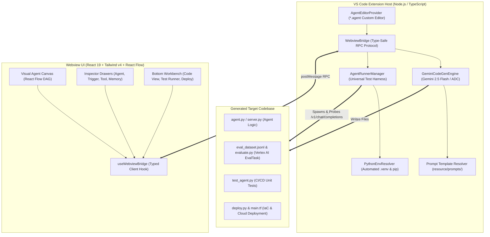
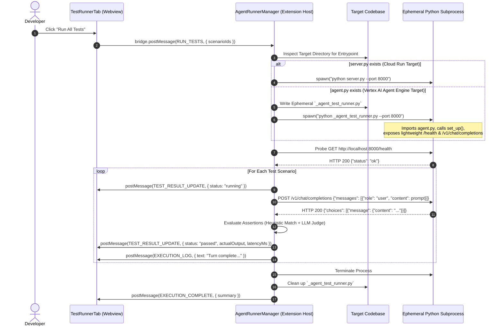

# Visual Agent Designer: Technical Architecture

> **Author**: Mike Nimer <mikenimer@google.com>  
> **Status**: Active / Production  
> **Repository**: `visual-agent-designer`  
> **Version**: 1.0.0  

---

## 1. System Overview

**Visual Agent Designer** is an enterprise-grade Visual Studio Code extension for visually designing, generating, locally executing, and deploying autonomous AI agent systems. 

Developers build agent graphs visually on a high-density DAG canvas, while the extension manages:
1. **Prompt-Driven LLM Code Generation**: Generates complete, idiomatic Python/TypeScript repositories tailored to specific frameworks (Google ADK, LangGraph, etc.) and deployment targets (Google Cloud Vertex AI Agent Engine, Google Cloud Run).
2. **Universal In-IDE Test Runner**: Executes interactive test suites with real-time token streaming, log capturing, and smart assertion scoring without coupling to production serving infrastructure.
3. **Google Cloud Vertex AI Agent Evaluation Integration**: Automatically produces evaluation datasets and `EvalTask` scripts for trajectory evaluation, tool accuracy validation, and cloud experiment tracking.
4. **Declarative Infrastructure as Code**: Generates minimal Terraform definitions and deployment scripts to provision required Google Cloud infrastructure.

---

## 2. High-Level Architecture

The system follows a decoupled, client-server architecture:



---

## 3. Subsystem Breakdown

### 3.1 Webview Single Page Application (UI)
* **Canvas Engine (`WorkflowCanvas.tsx`)**: High-performance DAG rendering using `@xyflow/react`. Manages nodes (`AgentNode`, `TriggerNode`, `ToolNode`, `RouterNode`), edge routing, auto-layout (Dagre), and pan/zoom viewports.
* **Property Inspectors (`*Drawer.tsx`)**: Side drawers allowing users to configure agent instructions, model selection, temperature, memory/session persistence, structured output schemas, and trigger scenarios.
* **Bottom Workbench Tabs**:
  * **Code View Tab (`CodeGenerationPanel.tsx`)**: Multi-file preview of generated code with syntax highlighting and manual code generation triggers.
  * **Test Runner Tab (`TestRunnerTab.tsx`)**: Live test execution dashboard displaying progress bars, token streaming, step latencies, stdout/stderr logs, and assertion pass/fail badges.
  * **Deployment Tab (`DeploymentTab.tsx`)**: Cloud project selector, region configuration, service account configuration, and local runner console.

### 3.2 VS Code Extension Host (Backend)
* **`AgentEditorProvider.ts`**: Implements VS Code's `CustomTextEditorProvider` to handle `.agent` document loading, saving, dirty-state tracking, and multi-tab synchronization.
* **`WebviewBridge.ts`**: Bi-directional, type-safe RPC messaging bridge guaranteeing strictly typed message exchanges between webview and extension host.
* **`GeminiCodeGenEngine.ts`**: Loads target-specific prompt templates, injects the canvas JSON document, and invokes the Gemini API (using `GEMINI_API_KEY` or Vertex AI ADC) to generate parseable multi-file JSON codebases.
* **`PythonEnvResolver.ts`**: Discovers system Python installations, isolates a `.venv` in the target directory, and automatically installs project requirements without user intervention.
* **`AgentRunnerManager.ts`**: The execution orchestrator managing local subprocess lifecycles, ephemeral test servers, HTTP probing, and assertion evaluation.

---

## 4. Deep Dive: Universal Test Runner & Evaluation Architecture

Testing AI agents requires evaluating both **deterministic logic** (tool parameters, JSON schemas) and **probabilistic outputs** (natural language quality, hallucination prevention). Furthermore, agents can be deployed to diverse environments (containerized Cloud Run services vs serverless Vertex AI Reasoning Engines).

The **Visual Agent Designer Test Runner** solves this through a **Universal Agent Adapter Pattern** that decouples the test harness from the deployment target.

### 4.1 The Universal Agent Adapter Pattern

Depending on the deployment target selected by the user, the generated code differs:
* **Cloud Run**: Generates `server.py` (FastAPI server listening on `$PORT`).
* **Vertex AI Agent Engine**: Generates `agent.py` (`AgentReasoningEngine` class) without any HTTP server.

The Test Runner handles both targets transparently without requiring modifications to the production code:



### 4.2 The Ephemeral Test Server (`_agent_test_runner.py`)

When testing a Vertex AI Agent Engine or generic library agent where no production server exists, `AgentRunnerManager` dynamically writes an ephemeral adapter script (`_agent_test_runner.py`) directly into the target directory.

* **Zero External Dependencies**: Built entirely using Python's standard library `http.server`.
* **Dynamic Inspection**: Inspects `agent.py` for standard reasoning engine classes (`AgentReasoningEngine`, `ReasoningEngine`, `AgentWorkflow`, or top-level `query()` functions).
* **Standard OpenAI Format**: Translates standard `/v1/chat/completions` HTTP requests into `agent.query(prompt)` calls and returns standard OpenAI-compatible response JSON.
* **Auto-Cleanup**: The file is tracked in-memory by `AgentRunnerManager` and deleted immediately when the test run ends or when the VS Code editor is closed.

---

### 4.3 Multi-Tier Assertion Evaluation

The Test Runner evaluates actual agent responses against expected criteria using a two-tier evaluation engine:

1. **Tier 1: Fast Heuristic Matcher**:
   - **JSON Key-Value Matching**: Checks structured outputs against field conditions (e.g. `isBusiness: true`, `category: "refund"`).
   - **Regex / Substring Matcher**: Verifies string presence or exact patterns.
2. **Tier 2: LLM-as-a-Judge Fallback**:
   - For open-ended natural language criteria (e.g. *"Response should be polite and mention the return policy"*), the engine queries Gemini to evaluate semantic adherence and returns a detailed pass/fail reason.

---

### 4.4 Google Cloud Vertex AI Agent Evaluation Integration

In addition to interactive IDE testing, every Google Cloud agent generated by Visual Agent Designer includes a native **Vertex AI Agent Evaluation Suite**:

```
Generated Repository Structure
├── agent.py               # Core Reasoning Engine / Agent logic
├── deploy.py              # Vertex AI Agent Engine deployment script
├── main.tf                # Bare-minimum Terraform linking to existing project
├── test_agent.py          # Standalone pytest suite for CI/CD pipelines
├── eval_dataset.jsonl     # Golden evaluation dataset exported from visual triggers
└── evaluate.py            # Vertex AI EvalTask script (Trajectory & Groundedness)
```

#### What `evaluate.py` Does:
Using the official `vertexai.evaluation.EvalTask` SDK:
* **Trajectory Metrics**:
  * `trajectory_exact_match`: Asserts whether the multi-step agent chose the exact sequence of tools planned in the visual workflow.
  * `trajectory_precision`: Validates tool parameter precision.
  * `response_follows_trajectory`: Ensures final agent responses logically derive from tool outputs without hallucinations.
* **Quality & Safety Metrics**:
  * `groundedness`: Verifies factual grounding against reference documents.
  * `instruction_following`: Measures adherence to system instructions.
  * `safety`: Flags safety policy violations.
* **Vertex AI Experiments Logging**:
  * Evaluation runs automatically record results, latencies, and score distributions to **Vertex AI Experiments** in the Google Cloud Console.

---

## 5. Security & Secret Management

1. **Authentication Priority**:
   * **Explicit Key Override**: If `GEMINI_API_KEY` is supplied, it takes priority (useful for local development and CI).
   * **Application Default Credentials (ADC)**: When `GEMINI_API_KEY` is not present, the agent automatically falls back to Vertex AI with Google Cloud ADC (`gcloud auth application-default login` or Workload Identity).
2. **Ephemeral Artifact Isolation**:
   * Temporary execution scripts are constrained strictly to the active workspace directory.
   * Port collision detection ensures abandoned processes are safely terminated.
3. **Infrastructure as Code Safety**:
   * Terraform templates do not create new Google Cloud projects or hardcode sensitive credentials; they link to existing projects via variables.

---

## 6. Future Roadmap

* **Continuous Production Monitoring (BigQuery Sink)**:
  * Stream production user conversations, tool latencies, and token counts from Cloud Run / Agent Engine to partitioned BigQuery tables.
  * Schedule daily/weekly `EvalTask` jobs over production BigQuery logs to detect drift and regressions in production.
* **Multi-Framework Generators**:
  * LangGraph and TypeScript runtime generators.
* **Model Context Protocol (MCP) Tool Integration**:
  * Visual wiring of remote and local MCP tool servers.
