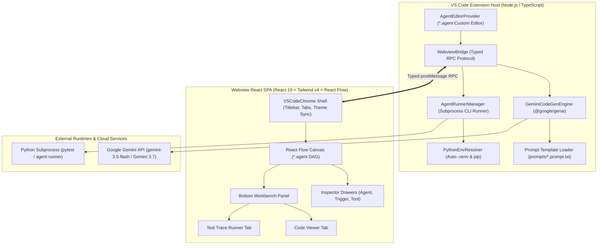
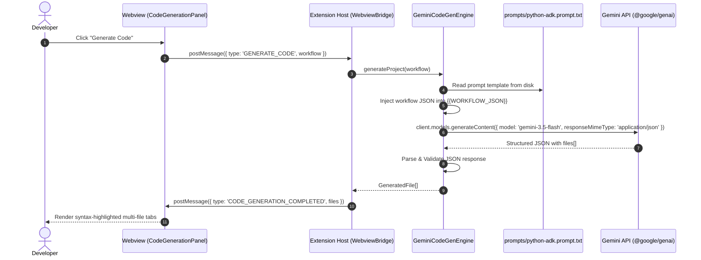
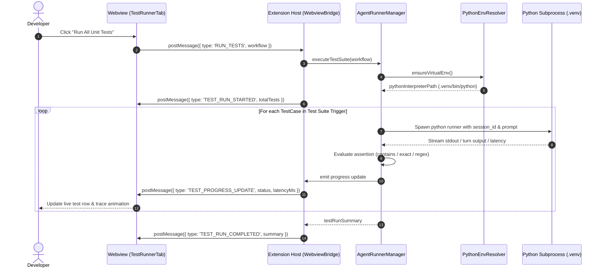
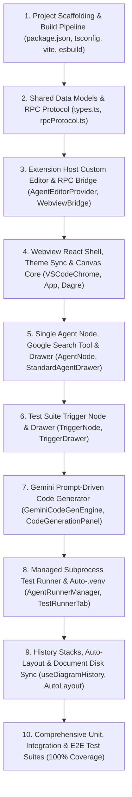

# Technical Design Document: Visual Studio Code Agent Flow Builder

> **Author**: Mike Nimer <mikenimer@google.com>  
> **Status**: Approved  
> **Document Version**: 1.0.0  
> **Target Release**: v1.0.0 (MVP Foundation)  
> **Related Documents**: [REQUIREMENTS.md](file:///Users/mikenimer/Development/projects/agent-designer/REQUIREMENTS.md), [RELEASE_PLAN.md](file:///Users/mikenimer/Development/projects/agent-designer/RELEASE_PLAN.md), [TASKS.md](file:///Users/mikenimer/Development/projects/agent-designer/TASKS.md), [prompts/python-adk.prompt.txt](file:///Users/mikenimer/Development/projects/agent-designer/prompts/python-adk.prompt.txt)  

---

## 1. The Problem

Modern AI applications increasingly rely on compound multi-agent architectures where specialized models, tools, and orchestrators collaborate to solve complex reasoning workflows. However, developing, testing, and deploying these multi-agent systems today suffers from major developer friction:

1. **High Cognitive Overhead & Brittle Glue Code**:
   Writing multi-agent orchestration code in Python or TypeScript requires hundreds of lines of boilerplate—defining tool call bindings, state passing schemas, conditional routers, error retries, and execution loops. Developers lack a visual mental model of how control and data flow across their agent graph.
2. **Disconnected Design & Development Cycles**:
   Product designers, prompt engineers, and backend developers often design agent flows in mockups or text documents, which must then be manually translated into code. Any architectural change requires labor-intensive synchronization across prompts, tool signatures, test suites, and deployment infrastructure.
3. **Complex Local Testing & Session Isolation**:
   Testing agent workflows locally requires standing up mock sessions, managing Python virtual environments, and manually asserting structured JSON outputs or tool traces. Developers lack an integrated, in-IDE test harness that runs assertions against isolated agent turns and visualizes trace latencies.
4. **Disjointed Cloud Infrastructure Provisioning**:
   Deploying an agent workflow to production platforms (such as Google Cloud Run or Vertex AI Agent Engine) requires writing custom Dockerfiles, Terraform scripts, Cloud Secret Manager bindings, and event subscriptions. This infrastructure setup is error-prone and slows down deployment velocity.

---

## 2. Overview

The **Visual Studio Code Agent Flow Builder** is an IDE extension that seamlessly integrates visual agent flow modeling, prompt-driven code generation, local session testing, and cloud infrastructure deployment directly inside the developer's everyday editor.

Developers interact with visual `*.agent` files on a high-density React Flow canvas embedded as a native VS Code custom editor. Instead of relying on brittle procedural AST generators, the extension utilizes **LLM prompt-driven code generation**: clicking "Generate Code" invokes Gemini (`@google/genai`) parameterized with dedicated framework prompt templates (`prompts/python-adk.prompt.txt`) to produce a complete, idiomatic Python repository (workflow orchestrator, tools, CLI runner, pytest suite, Dockerfile, and Terraform scripts).

Furthermore, the extension manages local Python virtual environments automatically, booting the agent in an isolated subprocess to execute test prompts and display live execution trace latencies and assertion results directly in the bottom workbench panel.

---

## 3. Goals

### Primary User Goals
- **Visual DAG Authoring**: Provide an intuitive, accessible visual canvas for defining agent nodes, attaching tools, and configuring triggers with zero friction.
- **Production-Grade Code Generation**: Generate complete, idiomatic, and runnable Google ADK Python projects using Gemini prompt templates that adhere to modern Google Cloud and Python engineering standards.
- **Integrated Local Test Harness**: Execute unit test suites against live agent sessions with automatic Python `.venv` provisioning and real-time step latency trace visualization.
- **Native VS Code Experience**: Fully integrate with VS Code's native shell (theme switching, custom editor document lifecycle, undo/redo history, split editors, and status bar metrics).
- **Extensible Multi-Release Architecture**: Establish a clean, modular foundation that scales from single-agent MVPs to complex multi-agent topologies (routers, A2A protocols, MCP tools, and multi-framework targets).

### Engineering & Quality Goals
- **100% Unit Test Coverage**: Ensure all backend extension host services, RPC bridge message handlers, prompt loaders, and webview hooks maintain comprehensive test coverage.
- **Automated Codegen Integration Testing**: Validate generated code syntax compilation (`py_compile`) and test suite execution (`pytest`) in automated CI pipelines.
- **Zero-Friction Workspace Sync**: Store `.agent` visual workflows as clean, version-controllable JSON files with dirty-state tracking and explicit code export.

---

## 4. Non-Goals (Scope Boundary for Release 1.0.0)

To guarantee high velocity, clean architecture, and rigorous testing, the following features are explicitly deferred to subsequent releases:

- **Non-Goal 1: Multi-Agent Canvas Wiring, A2A & Dynamic Routers (Deferred to v1.0.2 / v1.0.4 / v1.0.5)**:
  Release 1.0.0 focuses strictly on single-agent workflows. Multi-node DAGs, sequential prompt chains, parallel fan-outs, A2A nodes, and conditional router branching will be introduced in subsequent releases.
- **Non-Goal 2: Secondary Frameworks & Languages (Deferred to v1.1.0 / v1.1.1)**:
  Release 1.0.0 exclusively targets the **Google GenAI SDK / Google ADK in Python**. LangGraph will be delivered in v1.1.0 and TypeScript runtime in v1.1.1.
- **Non-Goal 3: Custom REST Tools & MCP Client Handshakes (Deferred to v1.0.6 / v1.0.8)**:
  Release 1.0.0 provides built-in `Google Search Grounding`. Custom HTTP REST builders and Model Context Protocol (MCP) clients are scheduled for dedicated tool milestones.
- **Non-Goal 4: Event-Driven Cloud Triggers & Enterprise IAM Auth (Deferred to v1.0.9)**:
  Release 1.0.0 provides the `Test Suite Trigger`. Cloud Pub/Sub, Cron Scheduler, Eventarc, and Google Cloud IAM service-to-service auth will be delivered in v1.0.9.
- **Non-Goal 5: Procedural AST Code Generation**:
  We do NOT construct procedural AST transformation pipelines. The LLM prompt template (`prompts/python-adk.prompt.txt`) is the single source of truth for code generation.

---

## 5. Technical Plan

### 5.1 Architectural Blueprint

The extension adopts a decoupled, client-server architecture consisting of the **VS Code Extension Host (Node.js/TypeScript)** backend and an embedded **Webview React Single-Page Application (SPA)** connected via a typed asynchronous RPC message bridge over `postMessage`.



---

### 5.2 Component Breakdown & Responsibilities

#### 1. Extension Host Backend (`src/extension/`)
- **`extension.ts`**:
  Entrypoint for VS Code activation. Registers custom editor provider `agentFlow.editor` for `*.agent` files and registers workspace commands (`agentFlow.newWorkflow`, `agentFlow.generateCode`, `agentFlow.runTests`).
- **`AgentEditorProvider.ts`**:
  Implements `vscode.CustomTextEditorProvider`. Manages the lifecycle of `.agent` documents:
  - Resolves webview panels with secure Content Security Policies (CSP) and local resource roots.
  - Ingests initial document content into the webview.
  - Subscribes to webview document mutations and invokes `vscode.workspace.applyEdit` to track dirty states and integrate with native VS Code undo/redo.
  - Dynamically computes relative target output folders based on `.agent` file location (`computeTargetFolder`).
- **`WebviewBridge.ts`**:
  Central RPC message dispatcher handling type-safe request/response pairs between webview and extension host.
- **`GeminiCodeGenEngine.ts`**:
  Handles LLM-driven code generation:
  - Reads `prompts/python-adk.prompt.txt` from disk.
  - Injects the serialized `.agent` JSON payload into `{{WORKFLOW_JSON}}`.
  - Invokes the `@google/genai` SDK using the developer's configured Gemini API key or Google Cloud Vertex AI credentials.
  - Parses the structured JSON response containing file objects (`agent_workflow.py`, `tools.py`, `main.py`, `test_pipeline.py`, `requirements.txt`, `main.tf`, `cloudbuild.yaml`, `Dockerfile`, `README.md`).
  - Provides a deterministic offline template generator fallback when API key is unconfigured.
- **`AgentRunnerManager.ts`**:
  Manages local test execution:
  - Dispatches test execution requests to `PythonEnvResolver`.
  - Passes each test scenario from the Test Suite trigger to the evaluation runner.
  - Evaluates assertion expressions (`contains_text`, `exact`, `regex`), calculates step latencies in milliseconds, and streams progress and logs (`EXECUTION_LOG`, `TEST_RESULT_UPDATE`, `EXECUTION_COMPLETE`) back to the webview.
- **`PythonEnvResolver.ts`**:
  Inspects the active workspace for a Python interpreter (via VS Code configuration `python.defaultInterpreterPath`, `VIRTUAL_ENV`, local `.venv`/`venv`/`env` candidate folders, or system `python3`/`python.exe`).

#### 2. Webview React Application (`src/webview/`)
- **`VSCodeChrome.tsx`**:
  Emulates native VS Code desktop window styling: title bar with window dots, breadcrumbs, tab buffer switcher for open `.agent` files, theme toggle, and collapsible, resizable bottom workbench panel adhering strictly to the **8pt grid system**.
- **`ThemeContext.tsx`**:
  Syncs UI themes dynamically with VS Code body classes (`vscode-dark`, `vscode-light`, `vscode-high-contrast`).
- **`App.tsx` & React Flow Canvas**:
  Hosts the interactive graph canvas (`@xyflow/react`):
  - Renders custom `AgentNode` and `TriggerNode` cards.
  - Enforces topology constraints: bottom-to-top layout for Agent-to-Agent connections; Test Suite trigger connects to Root node top/left; other triggers connect bottom-to-top.
  - Handles drag-and-drop from the left floating `PaletteCard`.
  - Manages node selection, deletion, duplication, undo/redo history, and Dagre auto-layout (`LR` / `TB`).
- **`StandardAgentDrawer.tsx`**:
  Slide-out inspector drawer (420px width) with accordion sections: Agent Identity, Model Selection (`gemini-flash-latest`, `gemini-3.5-flash`), Generation Parameters (temperature, max iterations), System Instructions editor with empty prompt placeholder, Attached Tools manager, and Root-only Memory & State persistence.
- **`TriggerDrawer.tsx`**:
  Inspector drawer for the Test Suite trigger: manages test cases list, prompt text inputs, expected output strings, and assertion types (`contains_text`, `exact`, `json_schema`, `regex`).
- **`CodeGenerationPanel.tsx`**:
  Multi-file code viewer embedded in the bottom workbench panel. Displays file hierarchy tree, syntax-highlighted code editor, one-click copy, and "Export Code to Workspace" action with relative folder computation.
- **`TestRunnerTab.tsx`**:
  Interactive test harness. Provides "Run All Unit Tests" and individual scenario execution, step latency breakdowns in milliseconds, assertion results (PASS / FAIL), and live execution logs.

---

### 5.3 Communication Protocol & Data Models

#### 1. Typed RPC Protocol (`src/shared/rpcProtocol.ts`)

```typescript
// Messages from Webview to Extension Host
export type WebviewToExtensionMessage =
  | { type: 'READY' }
  | { type: 'DOCUMENT_UPDATED'; payload: { document: AgentWorkflowDocument; docVersion: number } }
  | { type: 'GENERATE_CODE'; payload: { document: AgentWorkflowDocument; targetFramework?: FrameworkTarget; targetLanguage?: LanguageTarget } }
  | { type: 'EXPORT_CODE'; payload: { document: AgentWorkflowDocument; targetFramework: FrameworkTarget; targetLanguage: LanguageTarget; outputDirectory?: string } }
  | { type: 'WRITE_FILES_TO_WORKSPACE'; payload: { files: GeneratedFile[]; targetDirectory?: string } }
  | { type: 'RUN_TESTS'; payload: { document: AgentWorkflowDocument; testScenarioIds?: string[] } }
  | { type: 'CANCEL_TESTS'; payload: { runId: string } }
  | { type: 'OPEN_SETTINGS' }
  | { type: 'DISCOVER_MCP_TOOLS'; payload: { transport: 'stdio' | 'sse' | 'http'; command?: string; args?: string[]; url?: string } };

// Messages from Extension Host to Webview
export type ExtensionToWebviewMessage =
  | { type: 'LOAD_DOCUMENT'; payload: { document: AgentWorkflowDocument; docVersion: number; filePath?: string; readOnly?: boolean } }
  | { type: 'DOCUMENT_SAVED'; payload: { docVersion: number; timestamp: string } }
  | { type: 'THEME_CHANGED'; payload: { theme: 'dark' | 'light' } }
  | { type: 'CODE_GENERATED'; payload: { success: boolean; files: GeneratedFile[]; modelUsed?: string; error?: string } }
  | { type: 'FILES_WRITTEN'; payload: { success: boolean; paths: string[]; error?: string } }
  | { type: 'EXECUTION_LOG'; payload: { runId: string; timestamp: string; level: 'info' | 'warn' | 'error'; message: string; stepId?: string; agentId?: string } }
  | { type: 'TEST_RESULT_UPDATE'; payload: { runId: string; scenarioId: string; status: 'running' | 'passed' | 'failed'; durationMs: number; output?: string; error?: string } }
  | { type: 'EXECUTION_COMPLETE'; payload: { runId: string; success: boolean; durationMs: number; summary: string } }
  | { type: 'SETTINGS_SYNC'; payload: { geminiApiKeySet: boolean; targetFramework: FrameworkTarget; targetLanguage: LanguageTarget } };
```

#### 2. Workflow Document Data Model (`src/shared/types.ts`)

```typescript
export type AgentKind = 'standard' | 'router' | 'a2a';
export type TriggerKind = 'test' | 'chat' | 'pubsub' | 'scheduled' | 'eventarc' | 'manual' | 'webhook' | 'cron';
export type FrameworkTarget = 'google-adk' | 'langgraph';
export type LanguageTarget = 'python' | 'typescript';

export interface WorkflowNode {
  id: string;
  type: 'agent' | 'trigger';
  position: { x: number; y: number };
  data: AgentNodeData | TriggerNodeData;
  selected?: boolean;
}

export interface WorkflowEdge {
  id: string;
  source: string;
  target: string;
  sourceHandle?: string | null;
  targetHandle?: string | null;
  label?: string;
  animated?: boolean;
  data?: Record<string, unknown>;
}

export interface AgentWorkflowDocument {
  version: string;
  name: string;
  description: string;
  framework: FrameworkTarget;
  language: LanguageTarget;
  nodes: WorkflowNode[];
  edges: WorkflowEdge[];
  viewport?: { x: number; y: number; zoom: number };
  metadata?: { createdAt?: string; updatedAt?: string; author?: string };
}

export interface GeneratedFile {
  path: string;
  description?: string;
  content: string;
  language?: string;
}
```

---

### 5.4 Sequence Lifecycles

#### Lifecycle 1: Prompt-Driven Code Generation



#### Lifecycle 2: Managed Subprocess Test Runner



#### Lifecycle 3: Unified Self-Contained CLI & CI/CD Deployment (`UnifiedDeployRunner`)

Generated repositories include a self-contained `Makefile` (`install`, `dev`, `test`, `infra`, `deploy`), Terraform (`main.tf`, `variables.tf`, `outputs.tf`, `terraform.tfvars`), Cloud Build (`cloudbuild.yaml`), and Agent Engine packaging manifests (`.agent_engine_config.json`, `.ae_ignore`, `pyproject.toml`). Both the VS Code extension (`UnifiedDeployRunner`) and external CLI/CI/CD users invoke the exact same underlying commands without any procedural file mutation of `agent.py`.

---

## 6. Alternatives Considered & Trade-Off Analysis

### 6.1 Alternative 1: Procedural AST & Hardcoded String Template Generators
- **Concept**: Generate Python source code via procedural AST manipulation libraries or hardcoded TypeScript template literals.
- **Why Rejected**: Procedural generators are extremely fragile, require thousands of lines of maintenance overhead for every slight syntax change, and struggle to generate idiomatic, context-rich documentation, Dockerfiles, and Terraform configurations. Using prompt templates (`prompts/python-adk.prompt.txt`) with Gemini (`@google/genai`) produces far superior code quality, handles intricate topology nuances naturally, and makes adding new framework targets as simple as creating new prompt files.

### 6.2 Alternative 2: Background Auto-Generation on Every Edit
- **Concept**: Automatically invoking Gemini every time the `.agent` graph is modified or when switching tabs.
- **Why Rejected**: Auto-triggering causes unnecessary token spend, risks exceeding API rate limits, and creates disruptive editor latency during rapid canvas sketching. Requiring an explicit user action ("Generate Code" or "Export") provides predictable cost control and an intentional developer workflow.

### 6.3 Alternative 3: Simulated In-Webview Mock Test Runner Only
- **Concept**: Simulating agent turns purely with JavaScript client mocks inside the webview without executing real Python processes.
- **Why Rejected**: In-webview mocks fail to validate real Python SDK compatibility, dependency installations, actual Gemini model execution, or true tool grounding latencies. Spawning managed Python subprocess sessions in the Extension Host provides authentic validation.

### 6.4 Alternative 4: Monorepo Package Split (pnpm / Lerna)
- **Concept**: Splitting the repository into separate npm packages (`packages/extension`, `packages/webview`, `packages/codegen`).
- **Why Rejected**: Adds substantial tooling overhead, complex cross-package symlinking, and slower build cycles for a single cohesive extension. A unified root layout (`src/extension`, `src/webview`, `src/shared`) maximizes developer ergonomics and simplifies bundling.

### 6.5 Alternative 5: Standalone Web Application
- **Concept**: Deploying the designer strictly as a web application in the browser.
- **Why Rejected**: AI developers work daily inside IDEs. A native VS Code extension provides zero-friction access to workspace file systems, active virtual environments, integrated terminals, and version control.

---

## 7. Detailed Implementation Plan (Release 1.0.0)

### 7.1 Unified File Manifest

The table below enumerates every file created or modified for Release 1.0.0:

| File Path | Action | Rationale |
| :--- | :--- | :--- |
| `package.json` | [NEW] | Root extension manifest with VS Code custom editor contributions, commands, and npm build scripts. |
| `tsconfig.json` | [NEW] | Root TypeScript configuration. |
| `tsconfig.extension.json` | [NEW] | TypeScript build configuration for Extension Host (Node.js). |
| `tsconfig.webview.json` | [NEW] | TypeScript build configuration for Webview React SPA. |
| `vite.config.ts` | [NEW] | Vite bundler configuration for compiling Webview SPA to `dist/webview`. |
| `prompts/python-adk.prompt.txt` | [NEW] | Master prompt template for converting `.agent` JSON to Google ADK Python projects. |
| `src/shared/rpcProtocol.ts` | [NEW] | Type-safe RPC message definitions over `postMessage`. |
| `src/shared/types.ts` | [NEW] | Core domain interfaces for `.agent` documents, nodes, triggers, and generated files. |
| `src/extension/extension.ts` | [NEW] | Extension activation entry point registering editor and commands. |
| `src/extension/AgentEditorProvider.ts` | [NEW] | Custom editor provider binding to `*.agent` files, relative path computation, and managing document sync. |
| `src/extension/WebviewBridge.ts` | [NEW] | Central message dispatcher for webview RPC calls. |
| `src/extension/GeminiCodeGenEngine.ts` | [NEW] | Ingests prompt templates, calls `@google/genai`, and parses structured JSON files with offline fallback. |
| `src/extension/AgentRunnerManager.ts` | [NEW] | Manages test scenario execution, latency tracking, and assertion evaluation. |
| `src/extension/PythonEnvResolver.ts` | [NEW] | Resolves workspace Python environment and interpreter binaries. |
| `src/extension/types.ts` | [NEW] | Backend-specific process and runner types. |
| `src/webview/index.html` | [NEW] | Webview entry HTML with CSP security meta tags. |
| `src/webview/main.tsx` | [NEW] | React 19 root mounting `App.tsx`. |
| `src/webview/index.css` | [NEW] | Tailwind CSS v4 styling rules adhering to the 8pt grid system. |
| `src/webview/App.tsx` | [NEW] | Main webview component orchestrating React Flow canvas, drawers, and workbench. |
| `src/webview/context/ThemeContext.tsx` | [NEW] | Theme context synchronizing dark, light, and high-contrast themes. |
| `src/webview/hooks/useWebviewBridge.ts` | [NEW] | Custom React hook for posting typed RPC messages and listening to events. |
| `src/webview/hooks/useDiagramHistory.ts` | [NEW] | Undo/redo snapshot history manager (`Cmd+Z` / `Cmd+Y`). |
| `src/webview/components/vscode/VSCodeChrome.tsx` | [NEW] | VS Code desktop chrome shell (title bar, tabs, status bar, panel resizer). |
| `src/webview/components/Canvas/PaletteCard.tsx` | [NEW] | Left floating palette card for dragging agents, tools, and triggers. |
| `src/webview/components/Canvas/AutoLayout.ts` | [NEW] | Dagre auto-layout positioning algorithm (`LR` / `TB`). |
| `src/webview/components/Canvas/nodes/AgentNode.tsx` | [NEW] | Standard Agent custom React Flow node card with status and tool pills. |
| `src/webview/components/Canvas/nodes/TriggerNode.tsx` | [NEW] | Test Suite Trigger custom React Flow node card. |
| `src/webview/components/inspector/StandardAgentDrawer.tsx` | [NEW] | Slide-out inspector drawer for agent parameters, instructions, tools, and root memory. |
| `src/webview/components/inspector/TriggerDrawer.tsx` | [NEW] | Inspector drawer for test cases and assertion rules. |
| `src/webview/components/codegen/CodeGenerationPanel.tsx` | [NEW] | Bottom panel tab displaying generated file tree, syntax viewer, and relative export path. |
| `src/webview/components/testing/TestRunnerTab.tsx` | [NEW] | Bottom panel tab for running test suites and visualizing step trace latencies. |
| `src/webview/data/defaultTools.ts` | [NEW] | Built-in Google Search grounding tool definition. |
| `tests/extension/AgentEditorProvider.test.ts` | [NEW] | Unit tests for custom editor lifecycle and document sync. |
| `tests/extension/GeminiCodeGenEngine.test.ts` | [NEW] | Unit tests for prompt loading, template injection, and JSON parsing. |
| `tests/extension/AgentRunnerManager.test.ts` | [NEW] | Unit tests for test scenario execution and assertion evaluation. |
| `tests/extension/PythonEnvResolver.test.ts` | [NEW] | Unit tests for Python environment discovery and venv resolution. |
| `tests/webview/useDiagramHistory.test.ts` | [NEW] | Unit tests for undo/redo state stacks. |

---

### 7.2 Step-by-Step Execution Sequence



1. **Step 1: Scaffolding & Build Pipeline**:
   Set up root `package.json`, TypeScript build targets, Vite webview bundler, and esbuild extension host bundler.
2. **Step 2: Shared Types & RPC Protocol**:
   Implement type-safe RPC interfaces and domain types shared across extension host and webview.
3. **Step 3: Extension Host Core**:
   Implement `AgentEditorProvider` registering `agentFlow.editor` for `*.agent` files with document edit sync.
4. **Step 4: Webview Shell & Canvas**:
   Port VS Code UI chrome with 8pt grid Tailwind styling, theme context, and React Flow canvas container.
5. **Step 5: Single Agent & Tool**:
   Implement `AgentNode`, custom sockets, tool pill badges, and `StandardAgentDrawer`.
6. **Step 6: Test Suite Trigger**:
   Implement `TriggerNode` and `TriggerDrawer` for managing test cases and assertions.
7. **Step 7: Gemini Prompt Code Generation**:
   Implement `GeminiCodeGenEngine` loading `prompts/python-adk.prompt.txt`, invoking Gemini, and rendering multi-file tabs.
8. **Step 8: Managed Test Runner**:
   Implement `AgentRunnerManager` and `PythonEnvResolver` to auto-provision `.venv` and execute isolated test sessions.
9. **Step 9: History & Disk Sync**:
   Implement undo/redo snapshot stacks and Dagre auto-layout.
10. **Step 10: 100% Test Suite Verification**:
    Write unit tests, LLM codegen integration tests, and VS Code E2E tests.
