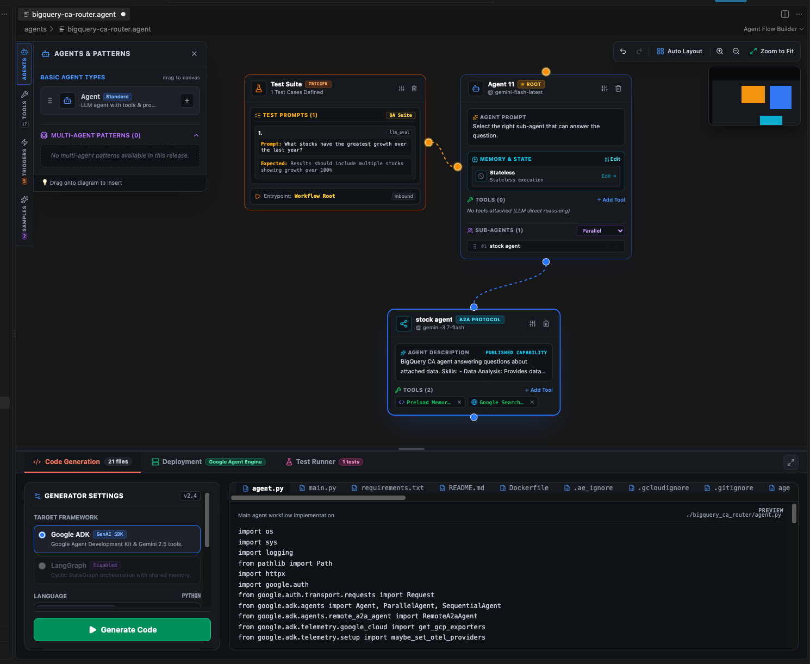
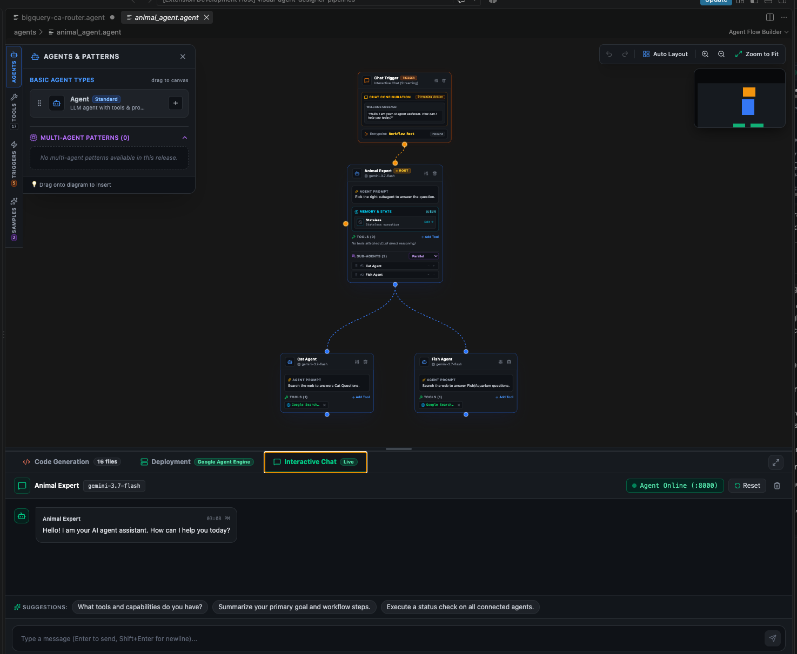

# Visual Agent Designer (Agent Flow Builder)

> **Author**: Mike Nimer <mikenimer@google.com>  
> **Platform**: Visual Studio Code Extension (`*.agent`)  
> **Core Frameworks**: Google Agent Development Kit (ADK) / Google GenAI SDK, LangGraph  
> **Deployment Targets**: Google Cloud Vertex AI Agent Engine (Reasoning Engine), Google Cloud Run  

---

**Visual Agent Designer** is an enterprise-grade Visual Studio Code extension that brings visual DAG canvas modeling, prompt-driven LLM code generation, in-IDE local execution and testing, and native Google Cloud deployment into your developer workspace.

Instead of writing hundreds of lines of brittle boilerplate to stitch together multi-agent topologies, tools, routers, and session memory, Visual Agent Designer enables you to model workflows visually in `*.agent` files, generate idiomatic Python/TypeScript repositories, run test suites against live subprocess sessions, and deploy directly to Vertex AI Agent Engine.

---

## 📸 Screenshots

### Multi-Agent Workflow & ADK Code Generation

*Visual canvas modeling a hierarchical multi-agent system with a Test Suite trigger, Root router agent, A2A (Agent-to-Agent) protocol sub-agent, and 21 automatically generated production files (Python ADK workflow, tools, test harness, Dockerfile, and Terraform).*

---

### Interactive Chat & Real-Time Parallel Agent Delegation

*Interactive Chat trigger fanning out requests across parallel specialist sub-agents (`Cat Agent` and `Fish Agent`) with Google Search Grounding and live streaming conversational testing in the workbench.*

---

## ✨ Key Features

- **🎨 Native VS Code Visual Canvas (`*.agent`)**:
  - High-performance React Flow DAG editor embedded as a native `vscode.CustomTextEditorProvider`.
  - Full support for Dark, Light, and High Contrast VS Code themes.
  - Multi-agent wiring with DAG connection validation, undo/redo history (`Cmd+Z` / `Cmd+Y`), Dagre auto-layout, and interactive minimap.

- **🤖 Diverse Agent & Trigger Nodes**:
  - **Standard LLM Agent**: Configurable system instructions, temperature, max iterations, and Gemini models (`gemini-3.7-flash`, `gemini-flash-latest`).
  - **A2A Protocol Node**: Agent-to-Agent decentralized interoperability adhering to the A2A JSON-RPC 2.0 protocol and `agent-card.json` capability declarations.
  - **Dynamic Router Node**: Intelligent routing via LLM intent classification, Python expressions, or confidence thresholds.
  - **Test Suite Trigger**: Define prompt scenarios and automated validation assertions (`contains_text`, `exact`, `regex_match`, `llm_eval`).
  - **Chat Trigger**: Live conversational entrypoint with streaming token delivery.

- **⚡ LLM Prompt-Driven Code Generation**:
  - Uses Gemini (`@google/genai`) and framework prompt templates to synthesize clean, runnable Python codebases tailored for the Google Agent Development Kit (ADK).
  - Automatically produces `agent.py`, `main.py`, `tools.py`, `test_agent.py`, `Dockerfile`, `cloudbuild.yaml`, and Terraform (`main.tf`).

- **🧰 Built-in & Extensible Tool Registry**:
  - **Google Search Grounding**: Real-time web search grounding with optional domain filtering and dynamic thresholds.
  - **Vertex AI Search**: Enterprise datastore grounding with global location enforcement.
  - **System & Utility Tools**: Web Page Reader (`load_web_page`), Human-in-the-loop clarification (`request_input`), Preload Memory (`preload_memory`), and Sandboxed Python Code Execution.
  - **Model Context Protocol (MCP)**: Connect local or remote MCP servers over `stdio`, `sse`, or `http` transports.
  - **Custom REST API Builder**: Visually define endpoints, request parameters, and Secret Manager bindings.

- **🧪 Universal In-IDE Test Runner & Live Chat**:
  - Automatically provisions and manages local Python `.venv` environments.
  - Executes test scenarios in isolated subprocess sessions, capturing execution timings, tool calls, and assertion results.
  - Live interactive chat tab with token-by-token streaming.

- **☁️ Cloud Deployment & Lifecycle Management**:
  - **Vertex AI Agent Engine**: Containerized packaging, remote Cloud Build compilation, and deployment to serverless Agent Runtime (`agents-cli deploy`).
  - **Cloud Run & Terraform**: Generates minimal Terraform scripts for Cloud Run v2 services, Artifact Registry, IAM service accounts, and Secret Manager.

---

## 📦 How to Install the Latest Release

You can install pre-built release binaries (`.vsix`) directly from the GitHub repository:

### Step 1: Download the `.vsix` from GitHub Releases
1. Navigate to the **[Releases](https://github.com/cloud-gtm/visual-agent-designer/releases)** tab of this repository.
2. Under the latest release (e.g., `v1.0.0` or higher), expand the **Assets** section.
3. Download the package file ending in `.vsix` (e.g., `agent-flow-builder-1.0.0.vsix`).

### Step 2: Install into Visual Studio Code

#### Method A: Using the VS Code User Interface (Recommended)
1. Open **Visual Studio Code**.
2. Open the Extensions sidebar (`Cmd+Shift+X` on macOS or `Ctrl+Shift+X` on Windows/Linux).
3. Click the **`...`** (Views and More Actions) menu in the top-right corner of the Extensions view.
4. Select **Install from VSIX...**.
5. Select the `.vsix` file you downloaded in Step 1.
6. When prompted, reload or restart VS Code.

#### Method B: Using the Command Line
Run the following command in your terminal:
```bash
code --install-extension /path/to/downloaded/agent-flow-builder-*.vsix
```

---

## 🚀 Quickstart Guide

1. **Create an Agent Workflow File**:
   In any open workspace in VS Code, create a new file with the `.agent` extension:
   ```bash
   touch my_workflow.agent
   ```
2. **Open the Visual Editor**:
   Click on `my_workflow.agent` in the VS Code file explorer. The Visual Agent Designer canvas will open automatically.
3. **Assemble Your Graph**:
   - Drag an **Agent** node from the left palette onto the canvas.
   - Connect a **Chat Trigger** or **Test Suite Trigger** to the agent's input handle.
   - Attach tools (e.g. **Google Search Grounding**) by dragging them from the Tools palette directly onto the agent card.
4. **Generate Code**:
   In the bottom workbench, open the **Code Generation** tab and click **Generate Code**. The extension will synthesize a complete, runnable Google ADK repository in your project directory.
5. **Run Tests or Chat**:
   - Click **Run All Tests** in the **Test Runner** tab to execute validation scenarios in an isolated subprocess.
   - Or open the **Interactive Chat** tab to test streaming conversations with your agent live.
6. **Deploy to Google Cloud**:
   Switch to the **Deployment** tab, configure your GCP Project and Region, and deploy directly to Google Cloud Vertex AI Agent Engine.

---

## 🛠️ Building & Developing Locally

### Prerequisites
- **Node.js**: `v20.x` or later
- **npm**: `v10.x` or later
- **Python**: `3.10+` (recommended for local agent test execution)

### Setup & Build
```bash
# Clone the repository
git clone https://github.com/cloud-gtm/visual-agent-designer.git
cd visual-agent-designer

# Install dependencies
npm ci

# Compile extension host and webview bundles
npm run compile
```

### Running Tests
The project maintains a comprehensive unit test suite covering extension host services, RPC bridge handlers, and webview canvas state:
```bash
npm test
```

### Packaging a `.vsix` Locally
To build your own `.vsix` extension package:
```bash
npm run package
```
This produces an installable `.vsix` file in the root project directory.

### Debugging with the Extension Host
1. Open this repository in VS Code.
2. Press `F5` (or select **Run > Start Debugging**) to launch an Extension Development Host window.
3. Open or create any `*.agent` file in the debug host to test live changes.

---

## 📚 Architectural & Planning Documentation

- **[`ARCHITECTURE.md`](ARCHITECTURE.md)**: Technical architecture reference, Mermaid subsystem diagrams, and runtime patterns (Universal Agent Adapter, Vertex AI Evaluation).
- **[`DESIGN_DOC.md`](DESIGN_DOC.md)**: Google engineering technical design doc detailing problem statement, RPC protocols, and trade-offs.
- **[`REQUIREMENTS.md`](REQUIREMENTS.md)**: Functional specification detailing node parameters, inspector drawers, and UX matrices.
- **[`RELEASE_PLAN.md`](RELEASE_PLAN.md)**: 13-release master roadmap from single-agent MVP to advanced multi-agent patterns.
- **[`TASKS.md`](TASKS.md)**: Actionable task matrix and implementation tracking.

---

## 📄 License & Attribution

Developed by **Mike Nimer** (<mikenimer@google.com>). Released under the Apache 2.0 License.
