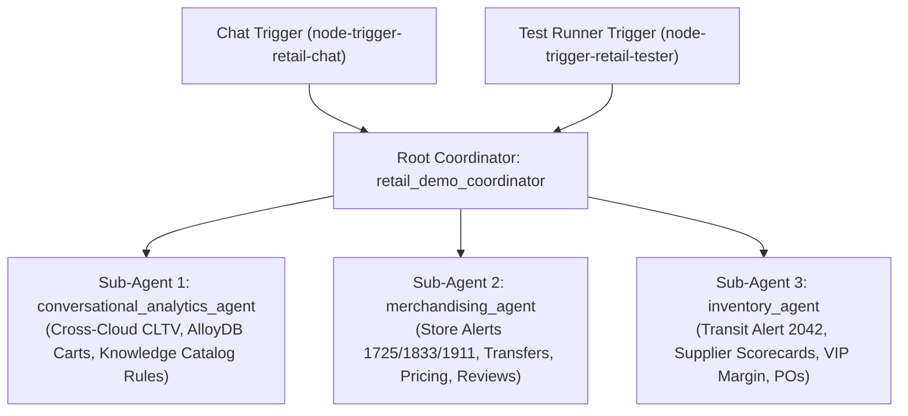

# ADR-001: Retail Data and AI Demo (`cloud-gtm/retail-data-and-ai-demo`) Unified Multi-Agent Architecture & Local SQLite Execution Plan

> **Author**: Mike Nimer <mikenimer@google.com>  
> **Status**: Deferred / Saved for Future Implementation (See [`TASK-215`](../../TASKS.md#task-215))  
> **Date**: 2026-10-19  
> **Source Repository**: [`https://github.com/cloud-gtm/retail-data-and-ai-demo`](https://github.com/cloud-gtm/retail-data-and-ai-demo) (Local clone: `/usr/local/google/home/mikenimer/Development/retail-data-and-ai-demo`)  
> **Reference Guide**: *Agentic Data Cloud - Retail : Demonstration Guide (Operationalizing Multi-Cloud Architectures and Conversational AI for Customer Retention)*

---

## 1. Context & Decision Summary

### Why We Removed the Previous `retail-data-and-ai-demo` Sample
An audit comparing our initial `resource/samples/retail/retail-data-and-ai-demo/` sample against the official `cloud-gtm/retail-data-and-ai-demo` repository revealed that the initial sample was a synthetic re-interpretation rather than a faithful port:
1. It invented a 5-sub-agent topology (`weather_trend_agent`, `inventory_audit_agent`, `pricing_optimization_agent`, `product_seo_agent`, `procurement_logistics_agent`) and a Cloud Spanner Graph database that did not exist in the original repository.
2. It omitted the 16 concrete Python tools, Pydantic models (`models.py`), and multi-step business SOPs from `agents/adk-agents/merchandising-agent`, `agents/adk-agents/inventory-agent`, and `agents/bigquery-data-agent`.
3. Because much of the official demo centers on showcasing BigQuery infrastructure (BigQuery Omni over AWS S3 Apache Iceberg tables, Datastream CDC from AlloyDB, and Dataplex Knowledge Catalog PDF extraction) rather than pure agentic reasoning, we decided to **remove the unfaithful sample now** and **preserve this complete architectural blueprint and local execution design** for when we want to build the faithful version later.

---

## 2. Source Repository & Demo Guide Architecture

Combining the **16-page Demonstration Guide** with the **cloned repository** reveals three distinct agent capabilities across two acts:

### Part A: Executive Demo Guide (Modules 1–4) — `conversational_analytics_agent`
Defined in `agents/bigquery-data-agent/manage_agent.py`, `frontend/docs/bigquery_schemas.md`, and `data/unstructured-data/Q3_Strategy_Shift_LTV_Targeting.pdf`:

1. **Module 1: Borderless Lakehouse (Determining CLTV Across Clouds)**
   - **Story**: **AuraGlobal** (GCP: `retail.customers`, \$5,502,023 revenue, avg CLTV \$1,831) acquired **ModaEco** (AWS S3 Apache Iceberg via BigQuery Omni: `retail_synthetic.aws_customers`, \$2,885,572 revenue, avg CLTV \$1,799).
   - **Unification**: Consolidating 4,609 separate customer records into `retail.combined_customers` yields **3,617 unique customer profiles** (\$8,664,068 total revenue, avg CLTV **\$2,395**), uncovering **992 cross-brand shoppers** and **507 loyalty tier upgrades** (e.g., Platinum increases from 442 to 672; Gold shifts from 883 to 931).
2. **Module 2: Active Lakehouse (Automating Cart Abandonment Remediation)**
   - **Story**: Real-time **AlloyDB** transactional cart sessions (`retail.carts`) are replicated to BigQuery via Datastream CDC (`daily_vip_cart_abandonment_evaluation`) to isolate `ABANDONED` checkouts and stale high-value `ACTIVE` carts (`total_amount >= 500` where `purchase_timestamp IS NULL`).
3. **Module 3: Knowledge Catalog (Ingesting Unstructured Business Rules)**
   - **Story**: Ingests Sarah Jenkins' strategy memo PDF (`Q3_Strategy_Shift_LTV_Targeting.pdf`) into Dataplex Knowledge Catalog Automatic Discovery to populate `retail.promotions` (`CustomerSegment`, `MarketingStrategy`, `Employee`, `Team`):
     - **LTV Tier Criteria**:
       - **Bronze Tier (\$0 – \$1,000)**: Aggressive win-back strategies (20–30% off / flexible white-glove BOPIS).
       - **Silver Tier (\$1,000 – \$2,000)**: Loyalty engagement (bonus points on next purchase).
       - **Gold Tier (\$2,000 – \$4,000)**: Margin preservation & experiential rewards (complimentary monogramming, early access to collection drops — **no blanket discounts**).
       - **Platinum Tier (>= \$4,000)**: Elite high-touch retention ('back-in-stock' priority reservations, private vault collections, exclusive runway invitations — **no blanket discounts**).
     - **Behavioral Segment Rules**:
       - **Top VIPs**: `ltv >= 3000` AND `recency <= 90 days`.
       - **Frequent Buyers**: `order_count >= 10` AND `recency <= 60 days`.
       - **Regular Shoppers**: `order_count BETWEEN 1 AND 9` AND `recency <= 120 days`.
       - **New Sign-ups**: `tenure_days <= 30` AND `order_count <= 1` AND (`recency <= 30 days` OR `NULL`).
4. **Module 4: Conversational Analytics (Natural Language Querying & Margin Impact)**
   - Identifies high-CLTV customers at risk of churning (`customer31` [\$6,989.03 LTV, 228 days inactive, active abandoned cart], `customer53` [\$8,592.71 LTV, 143 days inactive], `customer2754` [\$8,120.73 LTV, 281 days inactive], `customer17` [\$9,723.89 LTV, 672 days inactive]).
   - Executes the Verified Query joining `customers`, `aws_customers`, `synthetic_persons`, and `carts` for Top VIPs with `ABANDONED` or `ACTIVE >= $500` carts.
   - Evaluates the 24-hour VIP cart recovery campaign impact: **\$4,200 total recovered revenue** with **94% net profit margin preserved**.

### Part B: Operational Merchandising Agent — `merchandising_agent`
Defined in `agents/adk-agents/merchandising-agent/src/merchandising_agent/agent.py`:
- **Alert `alert-1725` (LA Store Portable AC Low Stock During SoCal Heatwave)**:
  - Runs a 14-day sales forecast (`get_product_sales_forecast`), compares current LA inventory (`21` units) against forecasted demand (`73` units), checks inventory across all nearby stores (`get_inventory_for_item_in_all_stores`), and recommends either a store-to-store transfer (`create_store_transfer_order`) or a supplier purchase order (`create_purchase_order`).
- **Alert `alert-1833` (SoCal Competitor Pricing Gap)**:
  - Evaluates current Portable AC price (`$229.99`) against SoCal competitors (`$255.99`, `$219.99`, `$262.99`, `$259.99`), calculates a new price in the **top 90% of competitors rounded to `.99`**, and executes `adjust_product_price`.
- **Alert `alert-1911` (`ACME-452` Wearable AC 1-Star Review Spike)**:
  - Analyzes customer review complaints (buyers mistaking a personal wearable cooling device for a room AC) and updates the catalog copy via `update_product_description`.

### Part C: Operational Inventory & Transit Disruption Agent — `inventory_agent`
Defined in `agents/adk-agents/inventory-agent/src/inventory_agent/agent.py`:
- **Alert `alert-2042` (Floriston Wildfire Near Reno Closing I-80 & Delaying Union Pacific Rail Shipment to LA Store)**:
  - Retrieves transit disruption details (`get_current_transit_alerts`), finds alternative suppliers for the delayed item **excluding the current supplier** (`get_suppliers_for_item`), and retrieves each supplier's KPI scorecard (`get_supplier_scorecard`: OTIF `72.3%`, Perfect Order Rate `95%`, Quality `96.2%`, Backorder Rate `4.1%`).
  - Performs a **Margin Impact Analysis** across **15 VIP customer requests** (comparing Current Margin vs. New Supplier Margin, Expedited Shipping Cost, and Total Financial Impact).
  - Presents and executes 3 corrective actions:
    1. **Cancel Current Purchase Order** (`cancel_purchase_order`)
    2. **Create New Purchase Order** (`create_purchase_order`)
    3. **Adjust Local Store Price** (`adjust_product_price`)

---

## 3. Unified Multi-Agent Canvas Topology ("Option B")

To allow a user to select **one sample** and experience the entire retail demo, we use a **Root Coordinator (`retail_demo_coordinator`)** delegating to **3 specialized sub-agents**:

### Complete Tool Inventory (16 Operational Tools + 4 Analytics Tools)

| Sub-Agent | Module | Tool Function | Purpose |
| :--- | :--- | :--- | :--- |
| **`conversational_analytics_agent`** | `tools/analytics_tools.py` | `compare_cross_cloud_cltv` | Compares GCP (`customers`), AWS Iceberg (`aws_customers`), and unified (`combined_customers`) CLTV and loyalty tier shifts. |
| **`conversational_analytics_agent`** | `tools/analytics_tools.py` | `get_knowledge_catalog_promotion_rules` | Returns LTV tier rules and customer segment definitions extracted from `Q3_Strategy_Shift_LTV_Targeting.pdf`. |
| **`conversational_analytics_agent`** | `tools/analytics_tools.py` | `get_high_cltv_churn_risk_customers` | Runs the Verified Query joining `customers`, `aws_customers`, `synthetic_persons`, and `carts` for at-risk VIPs. |
| **`conversational_analytics_agent`** | `tools/analytics_tools.py` | `get_vip_cart_recovery_margin_impact` | Calculates 24-hour VIP cart recovery revenue (\$4,200) and net profit margin preserved (94%). |
| **`merchandising_agent`** | `tools/retail_tools.py` | `get_current_merchandising_alerts` | Queries `merchandising_alerts` (`alert-1725`, `alert-1833`, `alert-1911`). |
| **`merchandising_agent`** | `tools/retail_tools.py` | `get_merchandising_alert_by_id` | Fetches a single merchandising alert by `alert_id`. |
| **`merchandising_agent`** | `tools/retail_tools.py` | `get_product_sales_forecast` | Generates N-day demand forecast (`days_ahead`, `store_id`, `item_id`). |
| **`merchandising_agent`** | `tools/retail_tools.py` | `get_inventory_for_item_in_all_stores` | Joins `store_inventory` + `stores` + `items` across all store locations. |
| **`merchandising_agent`** | `tools/retail_tools.py` | `create_store_transfer_order` | Transfers `quantity` of `item_id` from `source_store_id` to `destination_store_id`. |
| **`merchandising_agent`** | `tools/retail_tools.py` | `update_product_description` | Updates catalog description for `item_id` (`ACME-452`). |
| **`merchandising_agent` & `inventory_agent`** | `tools/retail_tools.py` | `get_item_by_id` | Looks up `Item` record from `items`. |
| **`merchandising_agent` & `inventory_agent`** | `tools/retail_tools.py` | `get_store_by_id` | Looks up `Store` record from `stores`. |
| **`merchandising_agent` & `inventory_agent`** | `tools/retail_tools.py` | `get_supplier_by_id` | Looks up `Supplier` record from `suppliers`. |
| **`merchandising_agent` & `inventory_agent`** | `tools/retail_tools.py` | `get_suppliers_for_item` | Finds all suppliers carrying `item_id` with unit cost, lead days, and MOQ. |
| **`merchandising_agent` & `inventory_agent`** | `tools/retail_tools.py` | `create_purchase_order` | Creates a new supplier purchase order (`PO`). |
| **`merchandising_agent` & `inventory_agent`** | `tools/retail_tools.py` | `adjust_product_price` | Updates local retail price (`new_price`) for `item_id` at `store_id`. |
| **`inventory_agent`** | `tools/retail_tools.py` | `get_current_transit_alerts` | Queries `transit_alerts` (`alert-2042` Floriston wildfire / rail delay). |
| **`inventory_agent`** | `tools/retail_tools.py` | `get_transit_alert_by_id` | Fetches a single transit alert by `alert_id`. |
| **`inventory_agent`** | `tools/retail_tools.py` | `get_supplier_scorecard` | Computes supplier OTIF, Perfect Order Rate, Quality, and Backorder KPIs. |
| **`inventory_agent`** | `tools/retail_tools.py` | `cancel_purchase_order` | Cancels a delayed supplier purchase order (`po_id`). |

---

## 4. Ordered Demo Prompts for the Test Runner (`node-trigger-retail-tester`)

When configured in `node-trigger-retail-tester`, these 10 prompts allow a presenter to walk through the entire demo in exact narrative sequence:

### Act I: Executive Demo Guide (Borderless Lakehouse, Knowledge Catalog & Cart Recovery)
1. **Demo Step 1 — Cross-Cloud CLTV Unification (Module 1)**
   - **Prompt**: `"Compare our AuraGlobal (GCP) and ModaEco (AWS Iceberg) customer datasets. How does unifying them into combined_customers change our total customer count, average CLTV, and Platinum/Gold loyalty tier distribution?"`
   - **Expected Output**: `3,617`
2. **Demo Step 2 — Knowledge Catalog Unstructured PDF Rules (Module 3)**
   - **Prompt**: `"What are the new Q3 LTV tier criteria, customer segment definitions, and margin-preservation rules extracted by Knowledge Catalog from the Q3_Strategy_Shift_LTV_Targeting.pdf strategy memo?"`
   - **Expected Output**: `Platinum`
3. **Demo Step 3 — High-CLTV Churn & Abandoned Cart Analysis (Modules 2 & 4)**
   - **Prompt**: `"Show me high-value loyalty customers currently at risk of churn based on our new abandonment rules."`
   - **Expected Output**: `customer31`
4. **Demo Step 4 — VIP Cart Recovery Margin Impact (Module 4)**
   - **Prompt**: `"What was the net profit margin impact of the VIP cart recovery campaigns over the last 24 hours?"`
   - **Expected Output**: `94%`

### Act II: Operational Merchandising Agent (`merchandising_agent`)
5. **Demo Step 5 — Store Merchandising Alerts Triage**
   - **Prompt**: `"Are there any current merchandising alerts across our stores?"`
   - **Expected Output**: `alert-1725`
6. **Demo Step 6 — LA Heatwave Stockout Forecast & Store Transfer (`alert-1725`)**
   - **Prompt**: `"Analyze alert-1725 for the Los Angeles store: check the 14-day demand forecast, check inventory across nearby stores, and recommend whether to execute a store-to-store transfer or supplier purchase order."`
   - **Expected Output**: `Los Angeles`
7. **Demo Step 7 — Competitor Pricing & Wearable AC Review Fix (`alert-1833` & `alert-1911`)**
   - **Prompt**: `"For alert-1833, calculate the new price in the top 90% of competitors rounded to .99 and adjust the price. Then check alert-1911 and update the product description to clarify that ACME-452 is a wearable air conditioner."`
   - **Expected Output**: `ACME-452`

### Act III: Operational Inventory & Transit Disruption Agent (`inventory_agent`)
8. **Demo Step 8 — Supply Chain Transit Disruption Alerts**
   - **Prompt**: `"Check for any current inventory or transit disruption alerts."`
   - **Expected Output**: `alert-2042`
9. **Demo Step 9 — Alternative Supplier Scorecard & VIP Margin Analysis (`alert-2042`)**
   - **Prompt**: `"For alert-2042, find alternative suppliers for the delayed item (excluding the current supplier), compare their OTIF and Perfect Order Rate scorecards, and calculate the margin impact across the 15 VIP customer requests."`
   - **Expected Output**: `OTIF`
10. **Demo Step 10 — Execute Supply Chain Corrective Actions (`alert-2042`)**
    - **Prompt**: `"Execute the recommended corrective actions for alert-2042: cancel the delayed purchase order and create a new purchase order with the top-rated alternative supplier."`
    - **Expected Output**: `cancelled`

---

## 5. Local Execution Plan (Before Deploying to GCP)

### Why Dual-Mode SQLite (`sqlite3`) + JSON Seed Fixtures Is the Ideal Architecture
In `agents/adk-agents/retail-shared/src/retail/bigquery_tools.py`, **100% of data lookups across all tools pass through two helper functions**:
- `execute_query(query: str) -> list[dict]`
- `get_single_row_from_query(query: str) -> Optional[dict]`

Furthermore, the Conversational Analytics agent executes relational SQL (`UNION ALL`, `LEFT JOIN`, `CASE WHEN`) across `customers`, `aws_customers`, `combined_customers`, `synthetic_persons`, `carts`, and `promotions`.

#### Architectural Design: `LocalSqliteBackend` in `bigquery_tools.py`
1. **Readable JSON Seed Fixtures (`data/seed/*.json`)**:
   - Copy the exact JSON/SQL datasets from the cloned repository into `data/seed/`:
     - `merchandising_alerts.json` (`alert-1725`, `alert-1833`, `alert-1911`)
     - `transit_alerts.json` (`alert-2042`)
     - `items.json`, `stores.json`, `suppliers.json`, `store_inventory.json`
     - `customers.json`, `aws_customers.json`, `combined_customers.json`, `synthetic_persons.json`, `carts.json`, `promotions.json`
2. **Zero-Config Local SQLite Auto-Bootstrap**:
   - Using Python's standard library `sqlite3` (zero external `pip` dependencies), `bigquery_tools.py` checks if `BIGQUERY_RUN_PROJECT_ID` is set in the environment.
   - **Local Mode (`BIGQUERY_RUN_PROJECT_ID` unset)**:
     - Automatically initializes a local SQLite database (`data/retail_demo_local.db` or `:memory:`) and populates each table from `data/seed/*.json` (converting nested arrays/dicts like `competitor_prices` or `available_items` to JSON text columns and parsing them back on read so Pydantic `model_validate()` works identically to BigQuery `STRUCT`/`ARRAY` rows).
     - Normalizes BigQuery table qualifiers in SQL strings (e.g., stripping `` `project.retail.customers` `` $\rightarrow$ `customers` and translating `CAST(x AS FLOAT64)` $\rightarrow$ `CAST(x AS REAL)`) before executing against SQLite.
     - Action tools (`create_purchase_order`, `cancel_purchase_order`, `create_store_transfer_order`, `adjust_product_price`, `update_product_description`) persist mutations into local SQLite tables so subsequent turns in the same session see updated prices, descriptions, and PO statuses.
   - **Cloud Mode (`BIGQUERY_RUN_PROJECT_ID` set)**:
     - Routes `execute_query(query)` directly to `google.cloud.bigquery.Client(project=BIGQUERY_RUN_PROJECT_ID)` and fails fast if credentials or datasets are missing.
3. **Zero Tool Signature Changes**:
   - Every tool in `retail_tools.py` and `analytics_tools.py` keeps the **exact same function signature, docstring, and Pydantic return model** whether running locally in the VS Code Test Runner or deployed to Vertex AI Agent Engine / Cloud Run.
