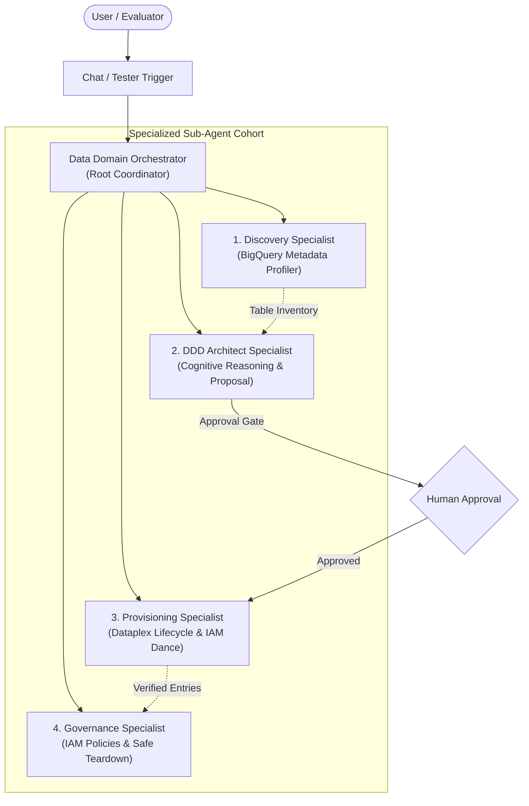

# Data Domain Builder (Google ADK Multi-Agent Blueprint)

> **Author**: Steve Thill <stevethill@google.com>  
> **Framework**: Google Agent Development Kit (`google-adk`)  
> **Model**: Gemini 3.7 Flash (`gemini-3.7-flash` via Vertex AI `global` location)  
> **Category**: Data Governance & Enterprise Architecture  
> **Target Run Times**: Local CLI, Cloud Run (FastAPI), Vertex AI Agent Engine  

---

## 1. Overview & Business Value

The **Data Domain Builder** is an autonomous multi-agent system designed to revolutionize how enterprise organizations design, provision, organize, and govern their data assets in **Google Cloud Dataplex (Knowledge Catalog)**.

Instead of manual, error-prone console clicks or complex ad-hoc scripts, this system applies **Domain-Driven Design (DDD)** principles to:
1. Automatically inventory datasets and tables across BigQuery without moving physical data.
2. Group tables into **Source-Oriented** (operational) and **Consumer-Oriented** (analytical) bounded contexts.
3. Strictly enforce the **Lowest-Level (Leaf) Subdomain Binding Rule** so physical resources map to operational teams.
4. Execute the **3-Step Granular Table IAM Authorization Dance** to authorize Dataplex domain service agents (`policyMember`).
5. Populate native Knowledge Catalog **Overview Aspects** with rich Markdown executive summaries.
6. Enable **Scoped Semantic Search** and provide **Safe Cascading Teardowns** with zero orphaned bindings.

---

## 2. Multi-Agent Cohort Architecture

The blueprint implements a hierarchical coordinator-specialist pattern with 5 specialized agents:

### Agent Roles & Responsibilities

| Agent Name | ADK Identifier | Purpose | Attached Tools |
| :--- | :--- | :--- | :--- |
| **Data Domain Orchestrator** | `root_agent` | Routes user intents, validates prerequisites, coordinates sub-agents, and enforces the Human Approval Gate. | *None (Pure Router)* |
| **Catalog Discovery Specialist** | `discovery_agent` | Inspects BigQuery datasets, tables, schemas, column descriptions, and row volumes. | `list_datasets`, `list_tables`, `get_table_schema` |
| **DDD Architecture Specialist** | `architect_agent` | Applies DDD bounded-context heuristics, enforces leaf binding rules, produces dual documentation, and formats proposals. | *None (Cognitive Reasoning)* |
| **Provisioning Specialist** | `provisioner_agent` | Checks exclusivity, provisions domains/subdomains, populates Markdown Overviews, and executes table IAM authorization & binding. | `create_domain`, `create_subdomain`, `get_domain_principal`, `authorize_table`, `authorize_dataset`, `bind_resource`, `set_overview`, `verify_binding_availability` |
| **Governance Specialist** | `governance_agent` | Manages domain IAM roles, executes scoped semantic searches within domain boundaries, and performs cascading safe deletions. | `get_iam_policy`, `add_iam_member`, `search_entries`, `cascading_teardown_domain`, `list_bindings`, `unbind_resource`, `delete_domain` |

---

## 3. Core Domain-Driven Design (DDD) Heuristics & Rules

### Rule 1: The Lowest-Level (Leaf) Subdomain Binding Rule
* Physical data resources (BigQuery tables, views, models) **MUST ALWAYS** be bound to the lowest-level (**leaf**) subdomain where day-to-day operational ownership sits.
* Parent domains serve exclusively as organizational, strategic, and functional groupings.
* **Violation Guard**: Physical resources must **NEVER** be bound directly to a parent domain if child subdomains exist!

### Rule 2: In-Place Governance for Shared / Monolithic Datasets
* If a single BigQuery dataset holds tables spanning multiple business capabilities (e.g. `retail_dw` containing `customers`, `orders`, and `inventory`), **do NOT duplicate or move data**.
* Keep physical data in place. Use `authorize_table` to grant table-level `roles/bigquery.metadataViewer` and bind each table directly to its appropriate leaf subdomain.

### Rule 3: 1:1 Resource Binding Exclusivity
* A BigQuery resource URI (`//bigquery.googleapis.com/...`) can be bound to **only ONE domain** across the entire Knowledge Catalog.
* The `verify_binding_availability` tool performs an exhaustive scan across existing domains before any binding mutation to fail fast if collisions exist.

### Rule 4: The Dual-Documentation Standard
Every domain and subdomain requires two distinct documentation tiers:
1. **Plain-Text Description**: A concise 1-2 sentence description (no markdown, no bullets) stored in `description` for high-level catalog search results and UI cards.
2. **Native Markdown Overview**: A rich, multi-section Markdown document attached as the native Knowledge Catalog `655216118709.global.overview` aspect.

---

## 4. The 6-Phase Autonomous Protocol

1. **Phase 1: Asset Inventory Discovery**: `discovery_agent` catalogs datasets, tables, column types, descriptions, and row volumes.
2. **Phase 2: DDD Modeling & Proposal**: `architect_agent` analyzes bounded contexts, determines parent-subdomain hierarchy, and presents a structured proposal.
3. **Phase 3: The Human Approval Gate**: The system pauses and awaits explicit confirmation from the human architect before creating any GCP resources.
4. **Phase 4: Dataplex Hierarchy Provisioning**: `provisioner_agent` provisions parent domains and nested subdomains.
5. **Phase 5: Native Overview Documentation**: Attaches rich Markdown Overviews with executive scopes and entity directories.
6. **Phase 6: 3-Step Leaf Table Binding Dance**:
   - **Step A**: Call `get_domain_principal` on the leaf subdomain to extract its `policyMember`.
   - **Step B**: Call `authorize_table` to grant `roles/bigquery.metadataViewer` directly on the target table.
   - **Step C**: Call `bind_resource` with the fully qualified table URI.
7. **Phase 7: Validation & Governance**: `governance_agent` verifies discoverability with scoped semantic search and provisions IAM access roles.

---

## 5. Built-in Evaluation & Tester Scenarios

The `kc-data-domain-builder.agent` blueprint includes 17 automated evaluation test cases ready to execute in the Visual Agent Designer Test Runner:

1. **Cold Start Project Asset Discovery**: Scans project and inventories datasets/tables.
2. **Deep Schema & Column Metadata Profiling**: Inspects column types, descriptions, and row volumes.
3. **Bounded Context Classification & DDD Proposal**: Evaluates operational vs analytical contexts.
4. **Lowest-Level (Leaf) Subdomain Binding Rule Check**: Asserts physical tables attach only to lowest-level leaf subdomains.
5. **Parent Domain Physical Binding Violation Guard**: Rejects binding physical tables directly to parent container domains.
6. **Shared Monolithic Dataset In-Place Governance**: Enforces granular table-level binding without moving data.
7. **Dual-Documentation Standard Verification**: Validates plain-text description and rich markdown overview generation.
8. **Human Approval Gate Enforcement**: Halts before provisioning to require explicit architect approval.
9. **Pre-Flight 1:1 Binding Exclusivity Collision Check**: Scans across all domains to prevent binding collisions.
10. **Dataplex Parent & Subdomain Hierarchy Provisioning**: Provisions parent and nested child subdomains.
11. **Subdomain Principal Identity Extraction (Step A)**: Extracts `policyMember` service account identity.
12. **Table-Level IAM Authorization Dance (Step B)**: Grants `metadataViewer` to the subdomain's `policyMember`.
13. **Leaf Table Resource Binding (Step C)**: Creates the Dataplex binding resource.
14. **Native Markdown Overview Aspect Publishing**: Verifies attachment of `655216118709.global.overview`.
15. **Scoped Semantic Search within Domain Boundaries**: Validates entry discovery strictly constrained by domain context.
16. **Domain IAM Access Governance Grant**: Grants `dataDomainViewer` role to business users.
17. **Safe Cascading Domain Teardown**: Unbinds resources, deletes child subdomains, and removes parent domain cleanly.

