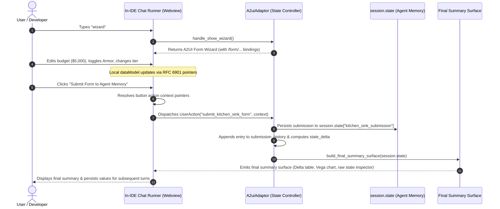

# A2UI v0.9.1 Kitchen Sink Component Gallery, Form Wizard & session.state Inspector

**Author:** Mike Nimer <mikenimer@google.com>  
**Target Platform:** Google ADK on Agent Runtime / Gemini Enterprise  
**UI Standard:** [A2UI v0.9.1](https://github.com/google/A2UI) (`gemini_enterprise_composite_v09` & `material_v09`)

---

## 1. Overview & Architecture

The **A2UI v0.9.1 Kitchen Sink** provides an exhaustive reference implementation and developer gallery for declarative, agent-generated user interfaces within the Visual AI Agent Designer.

It highlights three foundational pillars of the A2UI protocol:
1. **All-in-One Component Gallery (`widget_gallery_ui.py`)**:
   Renders 25+ Material 3 and Gemini Enterprise Composite components in a single surface (`kitchen-sink-gallery`) to demonstrate layout containers, typography, badges, progress bars, interactive two-way form controls, data tables, work order lists, Vega-Lite v5 charts, Google maps, and mosaic slide carousels.
2. **Interactive 3-Step Configuration Form Wizard (`form_wizard_ui.py`)**:
   A multi-step configuration wizard with a `Stepper` header and two-way RFC 6901 JSON pointer bindings (`/form/...`). Features 12 distinct form inputs (text, email, select dropdown, radio group, checkbox, slide toggle, chips, sliders, datepicker, timepicker) and a **Submit Form to Agent Memory** action button (`submit_kitchen_sink_form`) binding all 12 paths in its action context.
3. **Committed Values & `session.state` Verification Inspector (`final_summary_ui.py`)**:
   When the user submits the wizard, `A2uiAdaptor` resolves and intercepts the submission without LLM overhead, persists the submitted values into `session.state["kitchen_sink_submission"]`, updates submission history, emits a clean `state_delta`, and renders the **Final Summary Surface (`kitchen-sink-final-summary`)**.
   - Displays a field-by-field verification table with `CHANGED` vs `DEFAULT` badges.
   - Generates a dynamic `VegaChart` visualizing resource allocation breakdown based on the submitted compute budget.
   - Embeds a collapsible raw `session.state` JSON memory inspector.

---

## 2. Component Taxonomy

### Layout & Containers
- `MaterialCard`: Elevated surface card with title, subtitle, and child layout.
- `MaterialColumn` / `MaterialRow`: Flex layout containers with 8pt grid spacing and alignment.
- `MaterialGridList`: Multi-column tile layout.
- `MaterialExpansionPanel`: Accordion collapsible container with header title.
- `MaterialDivider`: Horizontal separator.
- `MaterialTabs`: Multi-panel tab navigation.
- `MaterialDialog`: Modal dialog container.

### Content & Feedback
- `MaterialText`: Heading and body typography (`body1`, `body2`, `headline`, `caption`, `code`).
- `MaterialBadge`: Pill badge with semantic color variants (`primary`, `success`, `warning`, `error`).
- `MaterialIcon`: Material Symbols icon element.
- `MaterialImage`: Responsive image with src, alt, and dimensions.
- `MaterialProgressBar` / `MaterialProgressSpinner`: Determinate and indeterminate loading indicators.

### Two-Way Bound Inputs (`{path: "/..."}`)
- `MaterialInput`: Text, email, number inputs bound to dataModel.
- `MaterialSelect`: Dropdown menu with options array.
- `MaterialRadioButton`: Single-choice radio group.
- `MaterialCheckbox`: Boolean toggle checkbox.
- `MaterialSlideToggle`: Material switch slider.
- `MaterialChips`: Multi-select interactive filter chips.
- `MaterialSlider`: Continuous/stepped numeric range slider.
- `MaterialDatepicker`: Date selection input.
- `MaterialTimepicker`: Time selection input.

### Composite Enterprise Components
- `MaterialTable` / `RichTable`: Structured tabular data with sorting and badges.
- `Stepper`: Multi-step process indicator with active, completed, and pending states.
- `VegaChart`: Declarative data visualizations executing Vega-Lite v5 specs.
- `GoogleMap`: Geographic map with center coordinates and pin markers.
- `MosaicCarousel` / `MosaicSlideCard`: Horizontal scrollable item cards with action dispatch.
- `WorkOrderList`: Structured ticket and work order feeds.

---

## 3. Data Flow & Two-Way Binding Lifecycle



---

## 4. Running the Tests

To run the automated Python test suite:
```bash
python3 -m unittest discover -s resource/samples/a2ui_kitchen_sink/tests -v
```

To run webview unit tests:
```bash
npx vitest run tests/unit/webview/A2UISurfaceRenderer.test.ts
```
